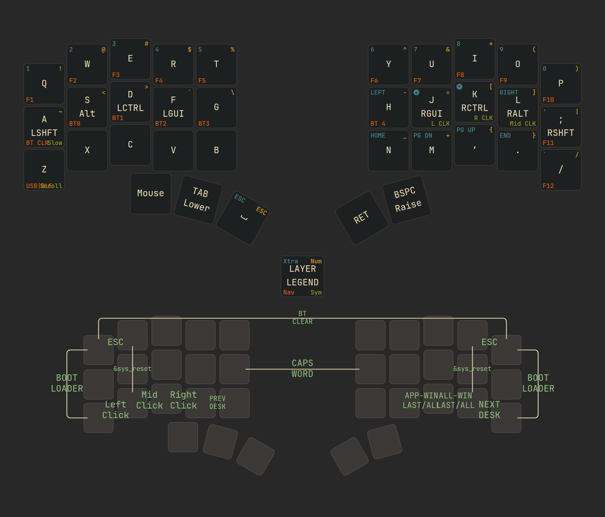

[](https://github.com/280Zo/charybdis-wireless-mini-zmk-firmware/actions/workflows/build.yml)

## Intro

This repository offers pre-configured ZMK firmware for the [Wireless Charybdis
keyboards](https://github.com/280Zo/charybdis-wireless-mini-3x6-build-guide?tab=readme-ov-file).

> [!IMPORTANT]
> This fork is configured for the **3x5 Charybdis Nano** (35 keys), not the 3x6.
> It builds **Bluetooth split only**, and the Prospector support is the
> **scanner** (a standalone listening device), not the display dongle.
> See [Differences from upstream](#differences-from-upstream).

It tracks ZMK `main` and uses the current input listeners and processors for
responsive pointer and scroll behavior.

## Overview & Usage

<!-- 
 -->
<picture>
  <source media="(prefers-color-scheme: dark)" srcset="keymap-drawer/stacked/stacked-combos-dark.png">
  <source media="(prefers-color-scheme: light)" srcset="keymap-drawer/stacked/stacked-combos-light.png">
  
</picture>


To see all the layers check out the [full render](keymap-drawer/all_layers/all_layers.svg).


**Keyboard Layers**
| # | Layer      | Purpose                                              | Reached by                     |
| - | ---------- | ---------------------------------------------------- | ------------------------------ |
| 0 | **BASE**   | Typing, with timeless home-row mods                  | default                        |
| 1 | **LOWER**  | Numbers and arrows                                   | hold TAB (left inner thumb)    |
| 2 | **RAISE**  | Symbols                                              | hold BSPC (right outer thumb)  |
| 3 | **SYSTEM** | F-keys, Bluetooth profiles, output toggle            | hold LOWER + RAISE (tri-layer) |
| 4 | **SCROLL** | Trackball becomes a scroll wheel; J/K/L click        | hold ESC (left outer thumb)    |
| 5 | **SLOW**   | Low-speed pointer for precision                      | double-tap + hold ESC          |


**Home-Row Mods**
| Side  | Hold = Modifier              | Tap = Letter / Key |
| ----- | ---------------------------- | ------------------ |
| Left  | **Shift / Alt / Ctrl / Gui** | `A S D F`          |
| Right | **Gui / Ctrl / Alt / Shift** | `J K L ;`          |

Side-aware: each key only becomes a modifier if the opposite half is also
active, so one-handed rolls never trigger a mod. `A`, `L` and `;` use
tap-preferred variants to further reduce misfires.


**Combos** (key positions, 3x5 numbering — see `config/keymap_features/combos.dtsi`)
| Trigger                   | Result                                    |
| ------------------------- | ----------------------------------------- |
| `G + H`                   | **Caps Word**                             |
| `Q + W` / `O + P`         | **Esc** (either hand)                     |
| `Z + X`                   | **Left click**                            |
| `X + C`                   | **Middle click**                          |
| `C + V`                   | **Right click**                           |
| `Q + Z` / `P + ?`         | **Bootloader** (same hand, either side)   |
| `W + X` / `O + .`         | **Soft reset** (same hand, either side)   |
| `Q + P`                   | **BT CLR** (clears the active profile)    |
| `V + B` / `. + ?`         | Previous / next desktop                   |
| `, + .` / `M + ,`         | All windows / app windows                 |

Bootloader and reset are deliberately **same-hand** — top plus bottom of one
column. Neither needs the other half, which matters when the split link is
exactly what you are trying to recover from.


**Other Highlights**
- **Prospector Scanner support:** the central broadcasts its status over BLE
  advertisements for a standalone [Prospector scanner](https://github.com/t-ogura/zmk-config-prospector)
  to display. The scanner never joins the split, so the keyboard stays a plain
  BT split.
- **Timeless-inspired home row mods:** based on [urob's](https://github.com/urob/zmk-config#timeless-homerow-mods)
  work, side-aware so a mod only fires when the opposite half participates.
  `A`, `L` and `;` use tap-preferred variants to reduce misfires on fast rolls.
- **Thumb-scroll mode:** hold the left outer thumb (position 30) and move the
  ball to scroll. Works on both axes, so sideways motion scrolls horizontally.
  High-resolution scrolling is on, so it is pixel-smooth rather than notched.
- **Precision cursor mode:** double-tap then hold that same thumb to drop the
  pointer speed; release to return to normal.
- **Clicks within reach:** `J` / `K` / `L` become left / right / middle click on
  the SCROLL layer, so one thumb holds while the other hand clicks from home
  position. The `Z+X` / `X+C` / `C+V` combos also work straight from BASE.
- **Tri-layer:** holding both layer thumbs opens SYSTEM, so F-keys and
  Bluetooth profiles cost no dedicated key.
- **Same-hand bootloader and reset:** neither needs the other half — see the
  combo table above.
- **PMW3610 low power trackball sensor driver:** provided by
  [badjeff](https://github.com/badjeff/zmk-pmw3610-driver), tuned here to
  3200 CPI with the speed set by the input scaler instead of the sensor, so
  granularity stays fine at any pointer speed.


## Differences from upstream

Things this fork does differently, and why — each is reversible and the
reasoning is repeated in a comment at the point of change.

| Change | Where | Why |
| ------ | ----- | --- |
| **3x5 layout** (35 keys) | `config/charybdis-layouts.dtsi`, `charybdis.dtsi` | Hardware is a Charybdis Nano. `five_column_transform` already existed upstream but no physical layout referenced it. |
| **Keymap restructured** to 6 layers | `config/keymaps/qwerty.keymap` | Cornix-style: BASE + LOWER + RAISE + tri-layer, plus the two trackball layers. Down from 8. |
| **Home-row mod order** `Shift Alt Ctrl Gui` | same | Matches the owner's other boards. Upstream used `Gui Alt Shift Ctrl`. |
| **ZMK Studio disabled** | `charybdis_right_bt.conf`, both build scripts | Workaround for [zmk#3195](https://github.com/zmkfirmware/zmk/issues/3195): a split central with `ZMK_SLEEP=y` + `ZMK_STUDIO=y` on Zephyr 4.1 cannot wake from deep sleep and needs a physical reset. The `studio-rpc-usb-uart` snippet has to go too — it sets up the same USB CDC ACM independently. |
| **BLE passkey entry disabled** | `config/charybdis/charybdis.conf` | `ZMK_BLE_EXPERIMENTAL_FEATURES` pulls it in implicitly. It forces typing a 6-digit code on the keyboard, impractical when the digits live on a held layer, and every failed attempt leaves a half-bonded profile. |
| **`force-awake` off** on the sensor | `charybdis_pmw3610.dtsi` | It made the driver rewrite the sensor's PERFORMANCE register on every idle transition. That SPI write races the interrupt-driven motion read, and with a level-triggered MOTION irq a corrupted burst makes the cursor run away and never stop. |
| **Prospector module swapped** | `config/west.yml` | `t-ogura` (scanner) replaces `280Zo` (display dongle). West forbids two projects with the same name, so the `dongle_prospector_*` build entries no longer build. |
| **Device renamed** `Chary Nano` | `Kconfig.bt.defconfig` | Hosts held stale bonds under the old name that blocked re-pairing. |

## Flash the Firmware

Download your choice of firmware from the Releases page. Choose a combination of format (Bluetooth/Dongle) and layout (QWERTY, etc.), then follow the steps below to flash it to your keyboard

1. Unzip the firmware bundle
2. One at a time, plug the devices into the computer through USB
3. Double press the reset button on the nice!nano
4. The keyboard will mount as a removable storage device
5. Copy the applicable uf2 file into the storage device
6. It will take a moment, then it will unmount and restart itself.
7. Repeat these steps for all devices.
8. If you've flashed one of the prospector dongle builds, you'll need to power on the dongle, then the left side before the right. This will sync the battery widget to the correct side.

> [!NOTE]
> If you are flashing the firmware for the first time, or if you're switching between the dongle and the Bluetooth/USB configuration, flash the reset firmware to all the devices first


## Customization

### Modify Key Mappings

**ZMK Studio — disabled in this fork**

[ZMK Studio](https://zmk.studio/) lets you edit the keymap at runtime, but it is
turned off here and the keymap has to be edited and reflashed instead.

The reason is [zmk#3195](https://github.com/zmkfirmware/zmk/issues/3195): on ZMK
`main` with Zephyr 4.1, a split **central** with both `ZMK_SLEEP=y` and
`ZMK_STUDIO=y` cannot wake from deep sleep. The peripheral wakes fine, so the
keyboard looks like it lost the other half, and only the physical reset button
recovers it. Disabling Studio is the workaround confirmed in that issue.

To re-enable it you need **three** changes, not one — Studio's USB CDC ACM also
arrives via a build snippet:

1. `CONFIG_ZMK_STUDIO=y` (plus the three locking options) in
   [charybdis_right_bt.conf](boards/shields/charybdis_right_bt/charybdis_right_bt.conf)
2. restore `-S studio-rpc-usb-uart` in [build_setup.sh](local-build/build_setup.sh)
   and `-DSNIPPET=studio-rpc-usb-uart` in
   [build.yml](.github/workflows/build.yml)
3. put `&studio_unlock` back on a key in [qwerty.keymap](config/keymaps/qwerty.keymap)

Expect the wake bug to come back unless you also set `CONFIG_ZMK_SLEEP=n`.


**Edit Keymap Directly**

To change a key layout, choose a behavior you'd like to assign to a key, then choose a parameter code. This process is more clearly outlined on ZMK's [Keymaps & Behaviors](https://zmk.dev/docs/features/keymaps) page. All keycodes are documented [here](https://zmk.dev/docs/codes).

Modify the [qwerty.keymap](config/keymaps/qwerty.keymap) or one of the behaviors, combos, or macros in the [keymap_features](config/keymap_features) folder, then follow the instructions below to build and flash the firmware to your keyboard.

### Modifying Trackball Behavior

The trackball uses ZMK's modular input processor system, making it easy to adjust pointer behavior to your liking. All trackball-related configurations and input processors are conveniently grouped in the [charybdis_pointer.dtsi](config/trackball/charybdis_pointer.dtsi) file. Modify this file to customize tracking speed, acceleration, scrolling behavior, etc. Then rebuild your firmware.

### Modify Build Format Selection

Build formats are also selected in [build.yaml](build.yaml).

To change which firmware families are built:

1. Open [build.yaml](build.yaml)
2. Find the build entry or entries you want to keep
3. Comment out or remove the entries you do not want

The main build families are:

- `bt`: Bluetooth split builds — **the only family this fork builds**
- `dongle_standard_nano`: no-screen dongle builds
- `dongle_prospector_*`: screen-enabled dongle builds using the Prospector adapter

> [!WARNING]
> The `dongle_*` entries **do not build in this fork.** `config/west.yml` swapped
> `prospector-zmk-module` from `280Zo` (display dongle) to `t-ogura` (scanner),
> and west does not allow two projects with the same name. The dongle configs
> under `config/dongle_prospector*` are left in place but unused.
>
> To get them back, point the module at `280Zo` again — and note that doing so
> removes the keyboard-side status advertisement the scanner relies on.

### Prospector Scanner

This fork supports the [Prospector **scanner**](https://github.com/t-ogura/zmk-config-prospector):
a standalone device that passively listens to BLE status advertisements. It does
not join the split, so the keyboard remains an ordinary BT split.

The keyboard side is three settings in
[charybdis_right_bt.conf](boards/shields/charybdis_right_bt/charybdis_right_bt.conf),
on the central only:

```conf
CONFIG_ZMK_STATUS_ADVERTISEMENT=y
CONFIG_ZMK_STATUS_ADV_KEYBOARD_NAME="ChryNano"   # max 8 chars
CONFIG_ZMK_STATUS_ADV_CENTRAL_SIDE="RIGHT"
CONFIG_ZMK_STATUS_ADV_ACTIVE_INTERVAL_MS=1000    # 1Hz; the default 200 is 5x the radio traffic
```

Layer, modifier and profile changes are sent as an immediate burst regardless of
that interval, so 1 Hz only slows the battery/WPM refresh — not the layer
indicator.

The scanner firmware itself is built from its own repository, not this one.

### Modify Keymap Selection

Keymaps live in [config/keymaps](config/keymaps) and are selected in [build.yaml](build.yaml).

To change which keymaps are built:

1. Open [build.yaml](build.yaml)
2. Find the `keymap:` list under the build entry you have picked
3. Keep the keymaps you want and comment out or remove the others

### Build the Firmware

To build the firmware follow either of the build processes below:

**Local Build - Single Command**

1. Clone this repo
2. Update the config files to match your use case
3. Follow the instructions in the [local-build README](local-build/README.md)
4. Firmwares will be available in the firmwares folder

**Pipeline Build - GitHub Actions**

1. Fork this repo
2. Update the config files to match your use case
3. Push changes and confirm the workflows are running
4. Firmwares will be available in the action artifacts


## Credits

- [badjeff](https://github.com/badjeff) for the PMW3610 ZMK driver used as the basis for the trackball sensor integration
- [carrefinho](https://github.com/carrefinho) for the original [Prospector](https://github.com/carrefinho/prospector) hardware and the [Prospector ZMK module](https://github.com/carrefinho/prospector-zmk-module/tree/feat/new-status-screens) this repo adapts for Charybdis dongles
- [eigatech](https://github.com/eigatech) for prior Charybdis dongle work and useful reference patterns around split trackball/input-listener integration
- [nickcoutsos](https://github.com/nickcoutsos/keymap-editor) for the browser-based keymap editor workflow
- [caksoylar](https://github.com/caksoylar/keymap-drawer) for the keymap rendering workflow and physical layout conversion tooling
- [urob](https://github.com/urob/zmk-config#timeless-homerow-mods) for the timeless home-row mod approach this keymap builds on and the stacked layer SVG inspiration
